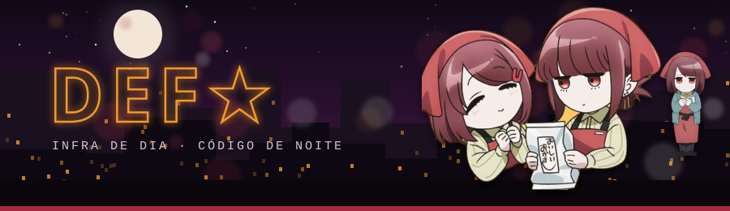

<h1>oi, eu sou o def★ ✨</h1>

<b>estagiário de infra por profissão, fuçador de placa e script por vocação</b>

Aqui é o cantinho de boa. Trabalho com **DevOps e DevSecOps** na [Itnex](https://github.com/itnex-io) (faço parte da org, sim, com crachá e tudo) e, no resto do tempo, monto coisa que ninguém pediu só porque ficou interessante.

Fico melhor de noite, com terminal aberto e um ruído de fundo. A Tayama fiscaliza.

 

---

<table>
<tr>
<td width="190" align="center"></td>
<td>

<h3>🛠️ o que ando aprontando</h3>

🏷️ <b>Etiquetas de gôndola com ESP32</b>: gateway próprio, sem depender da nuvem do fabricante 
🌡️ <b>Termômetro BLE</b>: sensor → ESP32 → Zabbix rodando num celular velho (sim, funciona) 
📺 <b>Painel de TV</b> em React + Node + Postgres, que mostra o fluxo do dia sem ninguém precisar perguntar 
🧥 <b>Provador virtual com IA</b> pra um ambiente de testes de estoque 
💸 <b>Yanisu</b>, meu app de finanças pessoais, com a Tayama de mascote (dados só no PC) 
📓 <b>Diário de estágio</b> em Go que escreve sozinho o que eu fiz no dia 
🔐 <b>Padrões de DevSecOps</b> pra Itnex: CI com Gitleaks, Trivy e Semgrep

</td>
</tr>
</table>

---

### 🧰 caixa de ferramentas

 

---

### 🍜 fora do expediente

Mexo em placa, tento fazer celular velho virar servidor e escrevo script pra não repetir tarefa chata. Se algo roda sozinho, fico feliz. Se roda sozinho **e** tem mascote, fico mais.

 

*chegou até aqui? então a Tayama aprova. agora vai dormir.*

